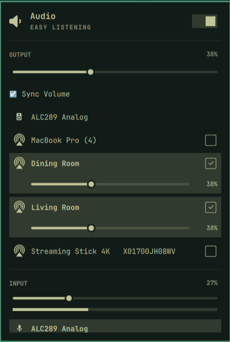

# OmaSound AirPlay

Native AirPlay 2 audio for Omarchy—one speaker or multiple rooms, with independent and synchronized volume controls.

OmaSound adds network speakers to Omarchy's Audio menu. Check one or more speakers and keep listening from your existing music player, browser, or other app. No playback commands are needed.



*Dining Room and Living Room selected, with Sync Volume enabled.*

## Features

- Discovers IPv4 AirPlay audio receivers through Avahi, including audio-capable AirPlay services without a separate RAOP record.
- Select speakers with checkboxes; volume sliders appear only for selected speakers.
- Independent volume per speaker. **Sync Volume** brings checked speakers to their average volume, then keeps their volumes linked until unchecked.
- Master volume, mute, and hardware volume keys reflect the active speaker or the group's average volume.
- Shared timing and the same scheduled start for multiroom AirPlay 2 playback.
- Audio-specific AirPlay icons, Omarchy theme colors, and the existing local output, microphone, and app mixer controls.
- Automatically closes connections and restores a physical output when disabled or unloaded.

## Compatibility

**v0.1.0 is an early release.** The original implementation was tested with two HomePods on OS 27, including simultaneous music playback. The portable package still needs a clean-install test on a second machine. Other detected receivers may require pairing, passwords, or protocols that this release cannot handle; discovery does not guarantee playback.

Requires an Omarchy installation with the Quickshell plugin API (`omarchy plugin`), PipeWire's PulseAudio compatibility service, and a local network that permits multicast discovery. This release ships sender checksums for x86_64 and aarch64; only x86_64 has been exercised here. PIN/password pairing, IPv6-only networks, and reliable mixed-generation multiroom groups are not supported in v0.1.0. Acoustic synchronization was checked by listening, not measured with instruments.

## Install

Install the plugin:

```sh
omarchy plugin add https://github.com/fterenas/omarchy-omasound-airplay
```

Open **Audio → Set up / repair AirPlay**. The setup opens a terminal, explains the changes, and asks before proceeding. It installs missing packages, enables Avahi discovery, and downloads a checksummed [cliairplay v0.5.5](https://github.com/music-assistant/airplay-cli/releases/tag/v0.5.5) binary. The sender is installed root-owned at `/usr/local/lib/omasound-airplay/cliairplay` with permission to bind timing ports (`cap_net_bind_service=ep`). It runs as your user.

Plugin installation itself runs no setup script and makes no privileged changes. If setup is cancelled, the usual local audio controls remain available. You can also run `python3 bin/setup.py` from a local checkout.

OmaSound replaces the stock `omarchy.audio` widget using Omarchy's supported clone metadata. If you already use a different audio-widget clone, disable that clone in bar settings and place OmaSound in its place. Keep only one audio-widget clone enabled.

If you are migrating from the development prototype, stop its separate `airplay-audio.service` before using OmaSound. This package does not change that service or import its settings automatically.

## Listen

1. Allow up to 20 seconds for network speakers to appear in Audio.
2. Check the speaker(s) you want. Existing application playback moves to the selected output.
3. Adjust the selected speakers' individual sliders, or enable **Sync Volume**. For example, 30% and 70% both become 50%; 35% and 70% both become 53%.
4. Choose a physical output or uncheck all speakers to return to local audio.

Changing the selected group restarts its connections and can briefly interrupt audio. Up to eight speakers can be selected; the tested group has two. The last active selection and per-speaker volumes are remembered and resumed when the plugin starts.

If UFW is enabled, selecting a speaker that needs AirPlay 2 timing opens an administrator prompt for an inbound rule allowing UDP 319–320 **from that speaker's IPv4 address only**. An existing rule is reused and is not claimed as OmaSound's own rule. No broad firewall disabling is performed. Receivers that change address need a new rule; old rules can be removed during cleanup.

## Disable or remove

Disabling OmaSound through Omarchy stops its worker and streams and restores the built-in audio widget. The worker allows up to 15 seconds for connection cleanup. Shared packages, the sender, saved settings, and firewall rules remain installed.

For dependency cleanup, run this **before removing the checkout**:

```sh
python3 "$HOME/.config/omarchy/plugins/io.github.fterenas.omasound-airplay/bin/uninstall.py"
omarchy plugin remove io.github.fterenas.omasound-airplay
```

Cleanup disables the plugin, removes its dedicated sender (including its port-binding permission), and offers to remove each timing rule recorded as created by OmaSound. Rules already present before OmaSound are kept. Shared packages and Avahi are kept because other software can use them. State under `${XDG_STATE_HOME:-$HOME/.local/state}/omasound-airplay` is retained; delete that directory separately if you want to forget speaker settings.

## Troubleshooting and development

See [troubleshooting](docs/TROUBLESHOOTING.md), [architecture](docs/ARCHITECTURE.md), [release notes](CHANGELOG.md), and [attributions](THIRD_PARTY_NOTICES.md).

```sh
omarchy plugin validate .
PYTHONPATH=bin python3 -m unittest discover -s tests -v
python3 -m compileall -q bin
```

The tests simulate discovery and audio tools, isolate saved state, and do not install dependencies or play sound. There is no plugin-managed systemd daemon: Omarchy loads `Service.qml`, which owns the discovery worker's lifetime.

## License

OmaSound's Python code and modifications are MIT licensed. The audio widget and model derive from Omarchy (MIT); their original copyright is retained. The external cliairplay executable is separately licensed, including GPLv3 components; it is not included in this repository or source archive. See [THIRD_PARTY_NOTICES.md](THIRD_PARTY_NOTICES.md) for its license and corresponding source links.
